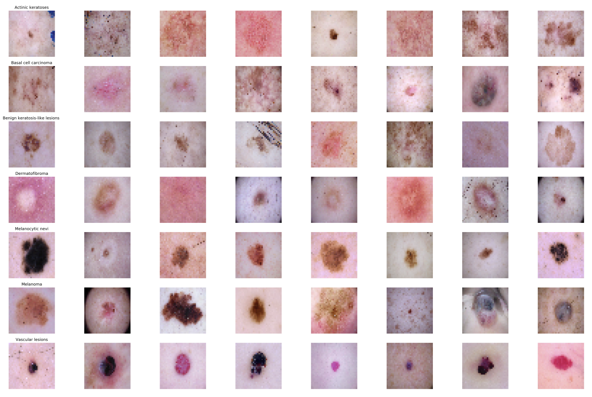
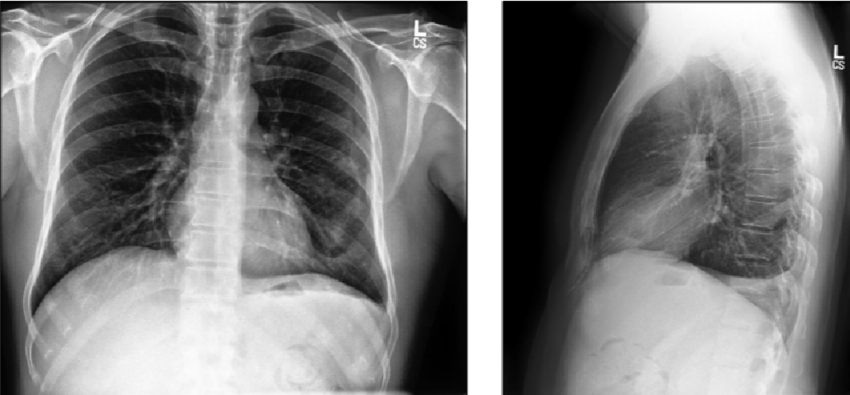
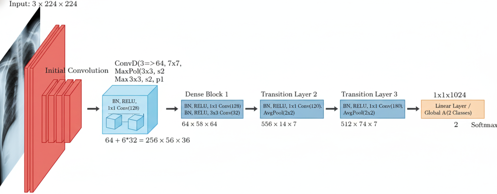
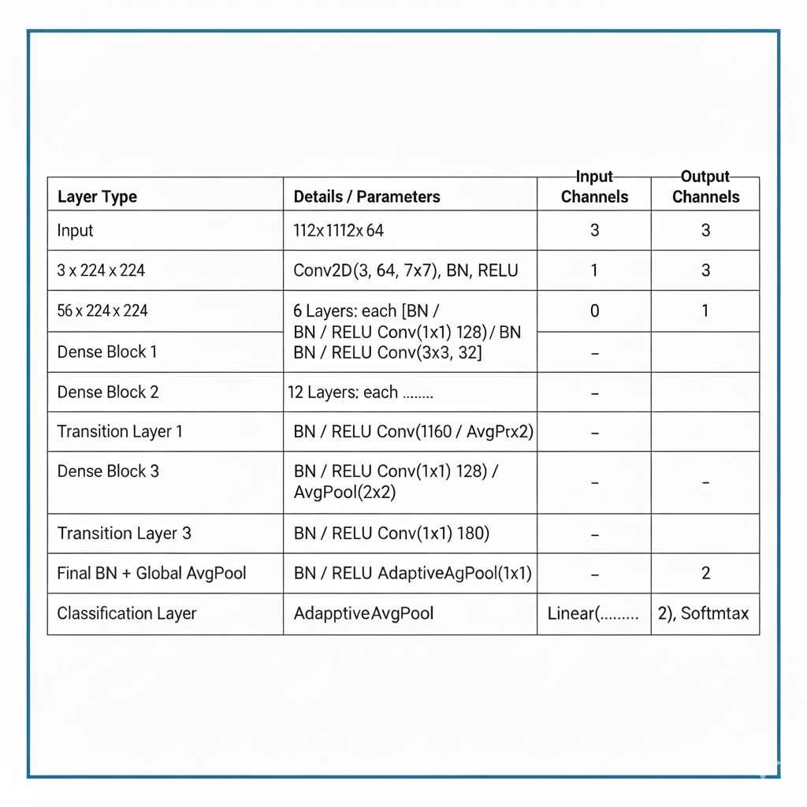
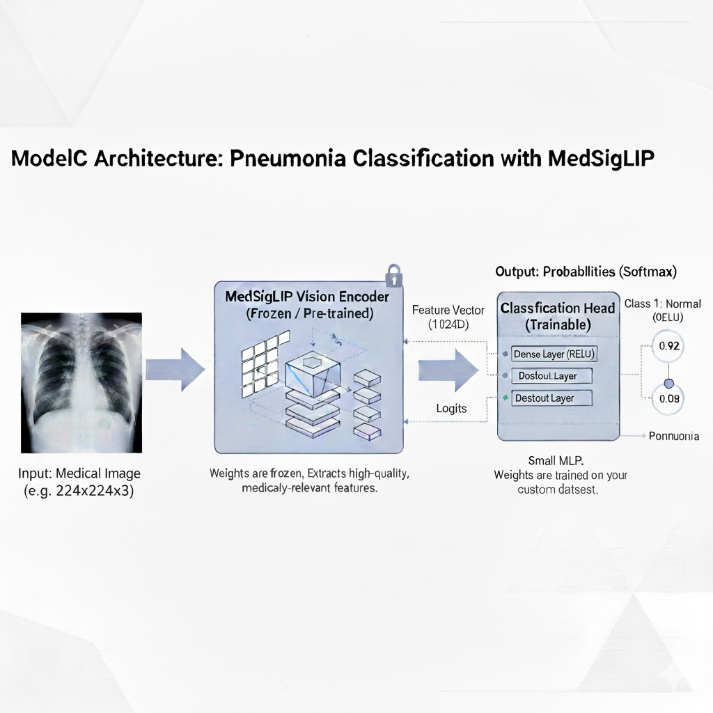

# Low-Medical-Imaging

This project tackles one of medical AI challenges: developing reliable diagnostic models when data is scarce. Through rigorous experimentation, we empirically validate whether transfer learning can overcome the "small data problem" that plagues specialized medical imaging applications. By comparing models trained from scratch against those leveraging pre-trained knowledge, we provide concrete evidence for best practices in low-resource clinical AI deployment.

## 🎯 Problem Statement

Medical AI development faces a critical data scarcity crisis. Creating effective diagnostic tools requires large, expertly annotated datasets, which are often impossible to obtain due to:

- 🔒 HIPAA privacy regulations limiting data sharing
- 💰 High annotation costs requiring medical expert time
- 🏥 Data rarity for specialized conditions and rare diseases

Training complex CNNs from scratch on small datasets leads to severe overfitting and unreliable performance on new patients. Transfer learning offers a promising solution, but requires rigorous empirical validation.

## 🔬 Project Overview

Every model is trained on only **300 labelled images** per task and evaluated on a large held-out test set, on three medical imaging tasks (pneumonia X-rays, dermatoscopy, CheXpert). The study asks two questions: how much does pretraining help in this low-data setting, and does domain-specific (medical) pretraining beat general pretraining?

**Comparison grid** (`MODEL_ZOO` in `src/protocol.py`). Each pretraining comparison keeps the architecture fixed, and every pretrained backbone is run in both training regimes, so pretraining is never mixed up with architecture or regime:

| Architecture | Pretraining | Linear probe (frozen backbone) | Full fine-tuning |
|---|---|---|---|
| DenseNet-121 | none (random init) | — | **A_scratch** |
| DenseNet-121 | ImageNet (general) | **B_imagenet_probe** | **B_imagenet_finetune** |
| SigLIP-400M ViT | SigLIP (general web images) | **C0_siglip_probe** | **C0_siglip_finetune** |
| SigLIP-400M ViT | MedSigLIP (medical) | **C_medsiglip_probe** | **C_medsiglip_finetune** |

**Planned comparisons** (`COMPARISONS` in `src/protocol.py`), each changing a single factor and Holm-corrected together:

| Comparison | Question |
|---|---|
| B_imagenet_finetune − A_scratch | ImageNet vs random init (DenseNet-121) |
| C_medsiglip_probe − C0_siglip_probe | medical vs general pretraining (SigLIP-400M, linear probe) |
| C_medsiglip_finetune − C0_siglip_finetune | medical vs general pretraining (SigLIP-400M, fine-tuned) |
| B_imagenet_finetune − B_imagenet_probe | fine-tuning vs linear probe (ImageNet DenseNet) |
| C_medsiglip_finetune − C_medsiglip_probe | fine-tuning vs linear probe (MedSigLIP) |

Comparisons across architectures (DenseNet vs ViT) also differ in architecture and scale, and are reported as such.

### Experimental protocol

**Shared protocol** (`PROTOCOL` in `src/protocol.py`), identical for every model:

| Setting | Value |
|---|---|
| Input | 448×448 for every backbone |
| Classification head | the same MLP for every model (see [Models](#-models)) |
| Training | 30 epochs, effective batch size 16 (gradient accumulation when a model needs smaller batches), AdamW, cosine schedule, weight decay 1e-4, gradient clipping 1.0 |
| Learning rates | head 1e-3; pretrained backbone 1e-4 when fine-tuned; whole network 1e-3 from random init. The same backbone grid (1e-5, 3e-5, 1e-4) is swept for every fine-tuned model |
| Augmentation | the same augmentation for every model on a dataset (strength 0.5): rotation, shift and horizontal flip for X-rays; for dermatoscopy also vertical flip and colour jitter |
| Model selection | best epoch on validation AUC, inside 5-fold stratified CV of the 300-image subset |
| Evaluation | every fold model is tested on the fixed held-out test set |

Only the backbone, its pretrained weights and its own input normalization differ. Frozen backbones are kept in eval mode, so their BatchNorm statistics don't change during training. Per-dataset settings (`DATASET_PROTOCOL`) apply to every model on that dataset: HAM10000 (~67% nv) uses class-weighted cross-entropy, so a model can't score well by predicting the majority class.

**Repeated subset draws.** The 5 folds of one 300-image subset reuse the same images, so their spread shows training variation but not how much a result depends on which 300 images were drawn. Each model is therefore trained on 5 independent subset draws (`subset_seeds` in `PROTOCOL`), with the full 5-fold CV on each and the test set fixed. A draw's score is the mean of its fold models. The run reports the mean across draws, the between-draw SD with a 95% t-interval, and the within-draw fold SD (`summarize_repeated_subsets`). Every model uses the same draws, so models are compared by the paired per-draw difference (`compare_paired_subsets`). Fold model initialization, data order and augmentation are seeded, so reruns give the same numbers.

**Metrics and statistics.** Headline metrics are macro AUC (binary AUC for pneumonia and CheXpert), balanced accuracy and macro-F1; accuracy is reported but not used to rank models, since on HAM10000 it mostly tracks the majority class. Every fold model's float32 test probabilities are saved, and `src/utils/stats_utils.py` computes:
- 95% CIs by stratified bootstrap over test cases (`ci_test_set`), and a two-level bootstrap that also resamples the subset draws (`ci_total`), so the interval covers both the finite test set and the choice of training images;
- paired model comparisons: a two-level paired bootstrap of the difference (CI and two-sided p-value) and, for binary AUC, DeLong's test on each draw's fold-ensemble scores;
- Holm-Bonferroni correction over the planned comparisons.

## 🗂️ Datasets

| Dataset | Task | Training subset | Test set |
|---|---|---|---|
| Chest X-ray (Pneumonia) | normal vs pneumonia | 300 images from the official train split | official test split: 624 images |
| HAM10000 | 7 skin-lesion classes | 300 images, one per lesion, from the training lesions | 1,441 images from 1,067 held-out lesions |
| CheXpert | Pleural Effusion (binary), frontal views | 300 images, one per patient | official validation split: 202 radiologist-labelled images |

**1. Chest X-ray Images (Pneumonia)** — Guangzhou Women and Children's Medical Center · [Kaggle](https://www.kaggle.com/datasets/paultimothymooney/chest-xray-pneumonia)

5,856 paediatric chest X-rays (JPEG) in two classes, NORMAL and PNEUMONIA, split into train (5,216), val (16) and test (624). The 300-image training subset is a stratified sample of the train split; the 16-image val split is not used, since the best epoch is chosen on the CV folds.


**2. HAM10000 Dermatoscopic Images** — Harvard Dataverse · [doi:10.7910/DVN/DBW86T](https://doi.org/10.7910/DVN/DBW86T)

10,015 dermatoscopic images of 7,470 pigmented skin lesions in 7 classes (akiec, bcc, bkl, df, mel, nv, vasc); about 67% are nv. Several images can show the same lesion, so the split is grouped by `lesion_id` (`make_ham10000_splits` in `src/data/HAM10000_dataset.py`):
- Test set: a lesion-grouped, class-stratified split of 1,441 images from 1,067 lesions. No lesion is on both sides.
- Training subset: one image per training lesion, then a stratified sample of 300 with at least 5 images per class.



**3. CheXpert** — Stanford ML Group · [paper](https://arxiv.org/abs/1901.07031) (CheXpert-v1.0-small)

Chest X-rays labelled for 14 findings (Pneumonia, Edema, Atelectasis, Pleural Effusion, etc.), each positive, negative, uncertain or unmentioned. This study uses one binary task, Pleural Effusion, on frontal (AP/PA) views (`make_chexpert_splits` in `src/data/chexpert_dataset.py`):
- Test set: the official validation split, 202 frontal images from 200 patients labelled by radiologist consensus (64 positive). None of these patients are in train.csv. With ~200 images, report the test AUC with a confidence interval.
- Training subset: train.csv images with a definite label (uncertain labels dropped; unmentioned treated as negative), one image per patient, then a stratified sample of 300 (about 30% positive, as in the training pool).
- `--chexpert_task` selects another finding (any train.csv column) with the same rules.



## 🧠 Models

All models share the same classification head on top of the backbone's pooled features (`ClassificationHead` in `src/models/ModelC.py`):

```
features (d) → LayerNorm → Dropout(0.3) → Linear(d, 512) → ReLU → Dropout(0.3) → Linear(512, n_classes)
```

Softmax turns the logits into probabilities, and the loss is cross-entropy (class-weighted on HAM10000). Every backbone is built by `build_model` in `src/models/backbones.py`.

**Models A and B: DenseNet-121** (torchvision; ~7.5M parameters with the head). A 7×7 convolution and max pooling, then four dense blocks (6, 12, 24 and 16 layers of 1×1 → 3×3 bottleneck convolutions, growth rate 32, each layer receiving the feature maps of all previous layers) joined by transition layers (BatchNorm → 1×1 conv → 2×2 average pooling), a final BatchNorm and global average pooling to a 1024-d feature vector (d = 1024).
- **A_scratch:** random initialization; the whole network is trained.
- **B_imagenet_probe / B_imagenet_finetune:** ImageNet weights, with the backbone frozen (only the head trains) or fine-tuned at a lower learning rate than the head.
- Inputs are normalized with ImageNet mean and std.




*Illustrative diagrams of DenseNet-121 from the original course report; the exact layer sizes are the ones in the text above.*

**Models C and C0: SigLIP-400M vision encoder** (ViT, 27 layers, hidden size 1152, patch 14; d = 1152, the pooled output).
- **C_medsiglip_probe / C_medsiglip_finetune:** MedSigLIP (`google/medsiglip-448`), trained on medical image–text pairs, native resolution 448. It is a gated model: see [MedSigLIP access](#4-medsiglip-access).
- **C0_siglip_probe / C0_siglip_finetune:** the general-domain SigLIP (`google/siglip-so400m-patch14-384`) with the same architecture, run at 448 with interpolated position embeddings. C0 vs C isolates domain-specific pretraining.
- Inputs are normalized with the model's own image-processor statistics (mean = std = 0.5, not ImageNet's), via `get_medsiglip_preprocessing()`.
- In the linear probe, the ~429M-parameter encoder is frozen and only the ~0.6M-parameter head trains; fine-tuning trains both, the encoder at a lower learning rate.



*Illustrative diagram of the MedSigLIP linear probe from the original course report. Current setup: 448×448 input, 1152-d features, and the head shown above.*

## 🛠️ Pipeline

1. **Data** (`src/data/`) — Chest X-ray, HAM10000 and CheXpert datasets (lesion-grouped HAM10000 splits, patient-level CheXpert splits) with built-in augmentation
2. **Models** (`src/models/backbones.py`) — one builder for every backbone, pretraining and regime in the comparison grid
3. **Protocol** (`src/protocol.py`) — the model grid, the shared training settings and the planned comparisons
4. **Training** (`src/utils/train_utils.py`, `src/utils/kfold_utils.py`) — k-fold training on each subset draw, saving the real per-fold test results, test probabilities and the across-draw summary
5. **Statistics** (`src/utils/stats_utils.py`, `compare_models.py`) — bootstrap CIs, DeLong's test, paired comparisons with Holm correction
6. **Plots** (`src/utils/plot_utils.py`) — training curves and per-fold test results
7. **Runner** (`run_experiment.py`) — runs one model on one dataset under the shared protocol; `compare_models.py` then builds the results table and runs the planned comparisons

```bash
python run_experiment.py --dataset pneumonia --model B_imagenet_probe
python run_experiment.py --dataset ham10000 --model C_medsiglip_finetune --batch_size 4 --grad_accum_steps 4
python run_experiment.py --dataset ham10000 --model B_imagenet_probe --monitor_metric val_balanced_acc
python run_experiment.py --dataset chexpert --model C_medsiglip_probe   # Pleural Effusion, frontal views
python run_experiment.py --dataset pneumonia --model A_scratch --smoke_test   # quick pipeline check
python run_experiment.py --dataset pneumonia --model B_imagenet_probe --subset_seeds 0   # one subset draw instead of all 5
python compare_models.py --dataset pneumonia                                # table with 95% CIs + planned comparisons
python compare_models.py --dataset ham10000 --metric test_balanced_acc
```

Outputs go to `experiments/` (`--out_dir`): per draw `<dataset>_<model>_sub<seed>_kfold_results.json` and `..._test_predictions.npz`, per run `..._subsets_summary.json` and `..._config.json`, and the saved split ids.

## 🚀 Quick Start

### 1. Install dependencies

```bash
pip install -r requirements.txt
```

### 2. Get the datasets

Download the three datasets from the links above. CheXpert-v1.0-small is also mirrored on Kaggle (`kaggle datasets download ashery/chexpert`).

### 3. Dataset structure

Place them in the repo root (or pass `--pneumonia_root`, `--ham_metadata`, `--ham_image_dirs`, `--chexpert_root`). Folder names are case-sensitive on Linux.

```
chest_xray_pheumonia/chest_xray/        # Kaggle Chest X-ray (Pneumonia)
├── train/
│   ├── NORMAL/
│   └── PNEUMONIA/
├── val/
│   ├── NORMAL/
│   └── PNEUMONIA/
└── test/
    ├── NORMAL/
    └── PNEUMONIA/

HAM10000_Dataset/
├── metadata/
│   └── HAM10000_metadata.csv           # image_id, lesion_id, dx, ... (Harvard Dataverse)
├── train_dir/                          # searched recursively for the original ISIC_*.jpg images;
│   ├── akiec/ … vasc/                  #   augmented copies in these folders are ignored
└── val_dir/
    ├── akiec/ … vasc/

CheXpert_Dataset/                       # CheXpert-v1.0-small; CSV paths are resolved under this folder
├── train/
│   └── patient00001/study1/view1_frontal.jpg
├── valid/
│   └── patient64541/study1/view1_frontal.jpg
├── train.csv
└── valid.csv
```

### 4. MedSigLIP access

MedSigLIP is gated. Accept the Health AI Developer Foundations terms on the [model page](https://huggingface.co/google/medsiglip-448), create a read token at <https://huggingface.co/settings/tokens>, and put it in a `.env` file in the repo root (gitignored):

```bash
HF_TOKEN=hf_...
```

`slurm/run_experiment.sbatch` loads `.env` automatically; for local runs, `export HF_TOKEN=...` or run `hf auth login`.

## 🖥️ Running on the Explorer cluster (Northeastern HPC)

The `slurm/` scripts run the experiments on Explorer's GPU partition. The code, data and environment live in `/scratch/$USER` because the 75 GB home quota is too small; scratch is not backed up, so copy results you want to keep.

```bash
cd /scratch/$USER/Low-Medical-Imaging        # repo clone with the three datasets in its root
mkdir -p logs
sbatch slurm/setup_env.sh                     # one-time: conda env in /scratch/$USER/envs/lowmed (torch, CUDA 12.6)

# one model on one dataset; any run_experiment.py arguments pass through
sbatch slurm/run_experiment.sbatch --dataset pneumonia --model B_imagenet_probe
# one job per subset draw, in parallel
sbatch --array=0-4 slurm/run_experiment.sbatch --dataset ham10000 --model C0_siglip_probe
# SigLIP / MedSigLIP fine-tuning needs a bigger GPU than a 16 GB V100
sbatch --array=0-4 --gres=gpu:a100:1 slurm/run_experiment.sbatch --dataset chexpert --model C_medsiglip_finetune
```

The `gpu` partition allows each user 8 submitted and 4 running jobs (each array task counts as one) and 8 hours per job. For longer lists, write one `sbatch` argument list per line in a queue file and let `slurm/submit_queue.sh` submit them as slots free up, from a CPU node:

```bash
# logs/queue.txt
--time=04:00:00 slurm/run_experiment.sbatch --dataset pneumonia --model C0_siglip_probe --subset_seeds 0
--time=04:00:00 slurm/run_experiment.sbatch --dataset pneumonia --model C0_siglip_probe --subset_seeds 1

sbatch slurm/submit_queue.sh logs/queue.txt
```

`compare_models.py` collects every draw of a model, whether the draws ran in one job or as separate jobs:

```bash
/scratch/$USER/envs/lowmed/bin/python compare_models.py --dataset pneumonia
```

## 📊 Results

The full grid is running on the Explorer cluster under the protocol above. The results table, with 95% CIs and the Holm-corrected comparisons from `compare_models.py`, will be added here when the runs finish.

## 📁 Project Structure

```
├── run_experiment.py          # run one model on one dataset (all subset draws)
├── compare_models.py          # results table with CIs + planned comparisons
├── requirements.txt
├── data.py, main.py, train.py, evaluate.py   # earlier course-version scripts, not used by run_experiment.py
├── slurm/
│   ├── setup_env.sh           # one-time environment build on Explorer
│   ├── run_experiment.sbatch  # GPU job for run_experiment.py
│   └── submit_queue.sh        # submits queued jobs within the QOS limits
├── src/
│   ├── protocol.py            # model grid, shared protocol, per-dataset settings, comparisons
│   ├── data/                  # chest_xray_dataset.py, HAM10000_dataset.py, chexpert_dataset.py
│   ├── models/                # backbones.py (all models), ModelC.py (head, MedSigLIP preprocessing)
│   └── utils/                 # train_utils.py, kfold_utils.py, stats_utils.py, plot_utils.py, subset_utils.py
└── images/                    # README figures
```
