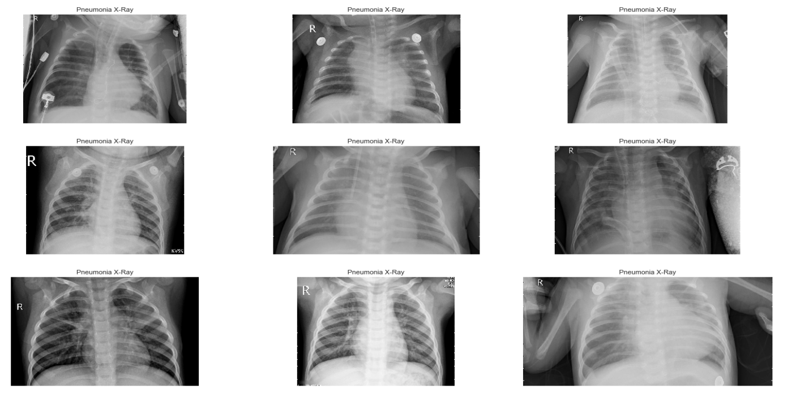

# Low-Medical-Imaging

This project tackles one of medical AI challenges: developing reliable diagnostic models when data is scarce. Through rigorous experimentation, we empirically validate whether transfer learning can overcome the "small data problem" that plagues specialized medical imaging applications. By comparing models trained from scratch against those leveraging pre-trained knowledge, we provide concrete evidence for best practices in low-resource clinical AI deployment.

# 🎯 Problem Statement

Medical AI development faces a critical data scarcity crisis. Creating effective diagnostic tools requires large, expertly annotated datasets, which are often impossible to obtain due to:

🔒 HIPAA privacy regulations limiting data sharing
💰 High annotation costs requiring medical expert time
🏥 Data rarity for specialized conditions and rare diseases

Training complex CNNs from scratch on small datasets leads to severe overfitting and unreliable performance on new patients. Transfer learning offers a promising solution, but requires rigorous empirical validation.

# 🔬 Project Overview

This project provides empirical validation of transfer learning efficacy in low-resource medical imaging scenarios through a controlled comparison.

**Comparison grid** (defined in `src/protocol.py`). Each pretraining comparison keeps the architecture fixed, and every pretrained backbone is run in both training regimes, so pretraining is never mixed up with architecture or regime:

| Architecture | Pretraining | Linear probe (frozen backbone) | Full fine-tuning |
|---|---|---|---|
| DenseNet-121 | none (random init) | — | **A_scratch** |
| DenseNet-121 | ImageNet (general) | **B_imagenet_probe** | **B_imagenet_finetune** |
| SigLIP-400M ViT | SigLIP (general web images) | **C0_siglip_probe** | **C0_siglip_finetune** |
| SigLIP-400M ViT | MedSigLIP (medical) | **C_medsiglip_probe** | **C_medsiglip_finetune** |

- **Effect of pretraining:** A vs B (DenseNet-121), and **C0 vs C for general vs domain-specific pretraining** (same SigLIP-400M architecture).
- **Effect of regime:** probe vs fine-tune for the same backbone and weights.
- Comparisons across architectures (DenseNet vs ViT) also differ in architecture and scale, and are reported as such.

**Shared protocol** (`PROTOCOL` in `src/protocol.py`), identical for every model: 448×448 input, the same classification head, the same augmentation, 30 epochs, effective batch size 16 (gradient accumulation when a model needs smaller batches), AdamW with a cosine schedule, the same learning rates per parameter group, the same backbone learning-rate grid for every fine-tuned model, model selection on validation AUC, and 5-fold CV with evaluation on a held-out test set. Only the backbone, its pretrained weights and its own input normalization differ. Frozen backbones are kept in eval mode, so their BatchNorm statistics don't change during training. Per-dataset settings (`DATASET_PROTOCOL`) also apply to every model: HAM10000 (~67% nv) uses class-weighted cross-entropy, so a model can't score well by predicting the majority class.

**Repeated subset draws.** The 5 folds of one 300-image subset reuse the same images, so their spread shows training variation but not how much a result depends on which 300 images were drawn. Each model is therefore trained on 5 independent subset draws (`subset_seeds` in `PROTOCOL`), with the full 5-fold CV on each and the test set fixed. A draw's score is the mean of its fold models. The run reports the mean across draws, the between-draw SD with a 95% t-interval, and the within-draw fold SD (`summarize_repeated_subsets`). Every model uses the same draws, so models are compared by the paired per-draw difference (`compare_paired_subsets`). Fold model initialization, data order and augmentation are seeded, so reruns give the same numbers.

**Metrics and statistics.** Headline metrics are macro AUC (binary AUC for pneumonia and CheXpert), balanced accuracy and macro-F1; accuracy is reported but not used to rank models, since on HAM10000 it mostly tracks the majority class. Every fold model's float32 test probabilities are saved, and `src/utils/stats_utils.py` computes:
- 95% CIs by stratified bootstrap over test cases (`ci_test_set`), and a two-level bootstrap that also resamples the subset draws (`ci_total`), so the interval covers both the finite test set and the choice of training images;
- paired model comparisons: a two-level paired bootstrap of the difference (CI and two-sided p-value) and, for binary AUC, DeLong's test on each draw's fold-ensemble scores;
- Holm-Bonferroni correction over the planned comparisons (`COMPARISONS` in `src/protocol.py`), each of which changes a single factor.

We utilize three distinct medical imaging datasets to simulate real-world transfer scenarios:  
**1. Chest X-ray Images (Pneumonia)**
Source: Guangzhou Women and Children's Medical Center  
Task: Pneumonia detection from chest radiographs  
Link: [Kaggle Dataset](https://www.kaggle.com/datasets/paultimothymooney/chest-xray-pneumonia)

**2. HAM10000 Dermatoscopic Images**
Source: Harvard Dataverse  
Task: Classification of common pigmented skin lesions  
Link: [Harvard Dataverse](https://doi.org/10.7910/DVN/DBW86T)

**3. CheXpert Dataset**
Source: Stanford ML Group  
Task: Pleural Effusion (binary) on frontal radiographs; tested on the radiologist-labelled validation split  
Link: [Stanford ML Group](https://arxiv.org/abs/1901.07031)

**Data Strategy**

Training Set: Deliberately constrained to 100-200 labeled images per condition  
Test Set: Large, unbiased holdout for reliable evaluation  
Augmentation: Aggressive augmentation

# Dataset Description

**1.Chest X-Ray Images (Pneumonia)**  
The dataset is organized into 3 folders (train, test, val) and contains subfolders for each image category (Pneumonia/Normal). There are 5,863 X-Ray images (JPEG) and 2 categories (Pneumonia/Normal).


**2.HAM10000 Dermatoscopic**
The HAM10000 dataset, a large collection of multi-source dermatoscopic images of common pigmented skin lesions.


**2.CheXpert**
The dataset includes labels for 14 thoracic pathologies (including Pneumonia, Edema, Atelectasis, Pleural Effusion, etc.) with four label types: positive, negative, uncertain, and unmentioned.
This study uses one binary task, Pleural Effusion, on frontal (AP/PA) views (`make_chexpert_splits` in `src/data/chexpert_dataset.py`):
- Test set: the official validation split, 202 frontal images from 200 patients labelled by radiologist consensus (64 positive). None of these patients are in train.csv. With ~200 images, report the test AUC with a confidence interval.
- Training subset: train.csv images with a definite label (uncertain labels dropped; unmentioned treated as negative), one image per patient, then a stratified sample of 300 (about 30% positive, as in the training pool).
- `--chexpert_task` selects another finding (any train.csv column) with the same rules.


## 🛠️ PyTorch Pipeline: Training & Evaluation

This project uses **PyTorch** for building and training transfer learning models. The pipeline consists of:

1. **Data** (`src/data/`) — Chest X-ray, HAM10000 and CheXpert datasets (lesion-grouped HAM10000 splits, patient-level CheXpert splits) with built-in augmentation
2. **Models** (`src/models/backbones.py`) — one builder for every backbone, pretraining and regime in the comparison grid
3. **Protocol** (`src/protocol.py`) — the model grid and the shared training settings
4. **Training** (`src/utils/train_utils.py`, `src/utils/kfold_utils.py`) — k-fold training on each subset draw, saving the real per-fold test results and the across-draw summary
5. **Statistics** (`src/utils/stats_utils.py`, `compare_models.py`) — bootstrap CIs, DeLong's test, paired comparisons with Holm correction
6. **Plots** (`src/utils/plot_utils.py`) — training curves and per-fold test results
7. **Runner** (`run_experiment.py`) — runs one model on one dataset under the shared protocol; `compare_models.py` then builds the results table and runs the planned comparisons:

```bash
python run_experiment.py --dataset pneumonia --model B_imagenet_probe
python run_experiment.py --dataset ham10000 --model C_medsiglip_finetune --batch_size 4 --grad_accum_steps 4
python run_experiment.py --dataset ham10000 --model B_imagenet_probe --monitor_metric val_balanced_acc
python run_experiment.py --dataset chexpert --model C_medsiglip_probe   # Pleural Effusion, frontal views
python run_experiment.py --dataset pneumonia --model A_scratch --smoke_test   # quick pipeline check
python run_experiment.py --dataset pneumonia --model B_imagenet_probe --subset_seeds 0   # one subset draw instead of all 5
python compare_models.py --dataset pneumonia                                # table with 95% CIs + planned comparisons
python compare_models.py --dataset ham10000 --metric test_balanced_acc
```

### Quick Start

#### 1. Install Dependencies

```bash
pip install -r requirements.txt
```

#### 2. Dataset Structure

For ChestXray Pheumonia Dataset:

```
dataset/
├── train/
│   ├── Normal/
│   │   ├── image1.jpeg
│   │   └── image2.jpeg
│   └── Pneumonia/
│       ├── image1.jpeg
│       └── image2.jpeg
├── val/
│   ├── Normal/
│   └── Pneumonia/
└── test/
    ├── Normal/
    └── Pneumonia/
```

For HAM10000 Dataset:

```
HAM10000/
├── train/
│   ├── akiec/
│   │   ├── image1.jpg
│   ├── bcc/
│   │   ├── image1.jpg
│   ├── bkl/
│   │   ├── image1.jpg
│   ├── df/
│   │   ├── image1.jpg
│   ├── mel/
│   │   ├── image1.jpg
│   ├── nv/
│   │   ├── image1.jpg
│   └── vasc/
│       ├── image1.jpg
├── val/
│   ├── akiec/
│   ├── bcc/
│   ├── bkl/
│   ├── df/
│   ├── mel/
│   ├── nv/
│   └── vasc/
```

For CheXpert Dataset (CheXpert-v1.0-small; paths in the CSVs are resolved under this folder):

```
CheXpert_Dataset/
├── train/
│   └── patient00001/
│       └── study1/
│           ├── view1_frontal.jpg
│           └── view2_lateral.jpg
├── valid/
│   └── patient64541/
│       └── study1/
│           └── view1_frontal.jpg
├── train.csv
└── valid.csv
```

## Model Architecture.

**ModelA : DenseNet from Scratch**.
**Architecture Details:**.

1. Input Layer: 3 × 224 × 224
2. Feature Extraction:

- Initial Layers.
  -- 7×7 convolution.
  -- BatchNorm + ReLU.
  -- 3×3 max pooling.
- Four Dense Blocks.
  Each block contains:  
  -- Bottleneck layers (1×1 conv → 3×3 conv).
  -- Dense connectivity (each layer receives feature maps from all previous layers).
  -- Growth rate: 32 channels per layer.
- Transition Layers.
  -- BatchNorm.
  -- 1×1 convolution.
  -- 2×2 average pooling.
- Final Representation.
  -- After the final Dense Block, outputs a 1024-dimensional feature vector.
  -- Global average pooling applied before classification.
  Core Components: [Main architectural blocks - conv layers, attention mechanisms, etc.].
  Output Layer: [Description of classification/regression head].


Figure 2: ModelA architecture diagram showing the flow from input to output

**ModelB : DenseNet121 Pretrained on ImageNet**.
**Architecture Details:**.  
Model B uses the same DenseNet121 architecture as Model A, but instead of starting from random weights, it begins with pretrained ImageNet weights.

Input Layer: 224x224x3
Feature Extraction:
Core Components:

1. Initial 7×7 convolution + max pooling.
2. 4 Dense Blocks, each containing:
   -Bottleneck layers (1×1 conv → 3×3 conv).
   -Dense connectivity (each layer receives input from all previous layers).
3. Transition Layers between blocks:  
   -BatchNorm → 1×1 conv → 2×2 avg pool.
4. Growth rate: 32.
5. Final feature map: 1024-dimensional.
6. Transfer Learning Strategy (both regimes are run, see the comparison grid):
   -Linear probe: backbone frozen (and kept in eval mode), only the classification head is trained.
   -Full fine-tuning: the whole network is trained, backbone at a lower learning rate than the head.

.
Figure 3: ModelA architecture diagram showing the flow from input to output.

**ModelC : MedSigLIP Vision Encoder (Frozen Feature Extractor)**.
**Architecture Details:**.

Input Layer:Dimensions: 448x448x3 (Height x Width x Channels - RGB).  
Preprocessing: Images are resized to 448x448 and normalized with the mean and standard deviation from the model's own Hugging Face image processor (mean = std = 0.5 for SigLIP models, not ImageNet stats), via `get_medsiglip_preprocessing()` in `src/models/ModelC.py`.  
Comparison: the general-domain SigLIP-400M (`google/siglip-so400m-patch14-384`, Model C0) is run with the same architecture and protocol, so C0 vs C isolates domain-specific pretraining. Both are run as a linear probe and with full fine-tuning.  
**Feature Extraction:**  
Backbone/Encoder Architecture: MedSigLIP Vision Encoder (based on the SigLIP-400M architecture). Status: Frozen (Non-trainable weights).  
Function: Extracts high-level, medically-aware features learned from millions of medical image-text pairs. It processes the input image and generates a single, dense feature vector.  
**Core Components:**
MedSigLIP Encoder: The main body of the model, which is a large Vision Transformer (ViT) variant. Classification Head (MLP): A simple, trainable Multi-Layer Perceptron used to map the extracted features to the final class labels. The structure is:

1. Dense Layer: 1152 (MedSigLIP embedding size), Output =512.
2. Activation: Rectified Linear Unit (ReLU).
3. Regularization: Dropout layer (rate =0.3).
4. Output Dense Layer: Input =512 , Output =2

**Output Layer:**.

Description: A two-unit Dense layer that outputs raw scores (logits).  
Final Activation: Softmax is applied to convert the two logits into probabilities.  
Loss Function: Cross-Entropy Loss (used for training the classification head).


Figure 1: ModelA architecture diagram showing the flow from input to output
